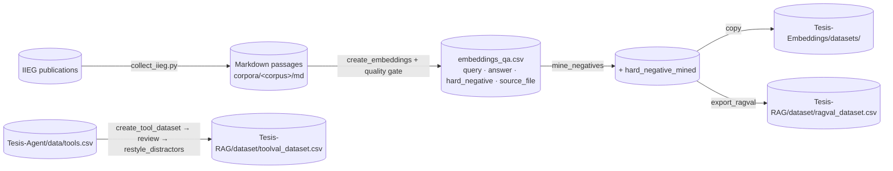

# Embedding Training Data Generator


   

Builds the synthetic data used to fine-tune and evaluate Spanish embedding models for two
retrieval tasks of an LLM agent: **context retrieval** (RAG) and **tool retrieval** (selecting the
right tool for a request). It turns source documents (PDF / Word) into Markdown and generates
`(query, answer, hard_negative)` triplets grounded in the facts of each passage, plus the
evaluation and control sets derived from them.

It is the first stage of a four-repository pipeline:

```
llm-synthetic-data-develop  →  Tesis-Embeddings  →  Tesis-RAG
  (this repo: data)            (fine-tuning, E1)     (E2 context retrieval, E3 tool retrieval)
                                                  ↖  Tesis-Agent (the agent whose tools E3 uses)
```

The repositories are expected to be cloned side by side in one directory; scripts reach their
siblings through `../<repo>`.

## Requirements

- Python 3.12+
- `pip install -r requirements.txt` (`docling`, `distilabel[openai]`, `sentence-transformers`,
  `datasets`, `pandas`, `jsonargparse`)
- For the generation commands: an OpenAI-compatible endpoint. The default configs point at an
  [Ollama](https://ollama.com) server (`base_url: http://localhost:11434/v1`); clear `base_url` and
  export `OPENAI_API_KEY` to use the OpenAI API instead.
- `collect_iieg.py` additionally needs `curl` and Poppler's `pdfinfo` / `pdftotext`.

## Data flow



`pdf2md.py convert` is the alternative entry for arbitrary PDF/DOCX files (docling).

## Commands

Every command reads its parameters from a YAML file in `configs/`; edit the config instead of
passing flags. Several `--config` files can be stacked, later ones override earlier ones.

```bash
python synthetic.py <command> --config configs/<file>.yaml
```

| Command | What it does | Config |
|---|---|---|
| `python collect_iieg.py` | Downloads a varied sample of IIEG publications (2023–2025), extracts and deduplicates passages into `corpora/iieg_diverso_2023_2025/` | — |
| `python pdf2md.py convert` | Converts every PDF/DOCX under a directory to Markdown with docling | `pdf2md.yaml` |
| `create_embeddings` | One grounded query and one LLM-authored hard negative per passage (distilabel `GenerateSentencePair`), filtered by the quality gate; rejects go to `rejected_qa.csv` | `create_embeddings.yaml` |
| `refilter` | Re-applies the passage cleaning and the quality gate to an existing CSV, without regenerating | `refilter.yaml` |
| `mine_negatives` | Adds `hard_negative_mined`: a real corpus passage found by embedding similarity | `mine_negatives.yaml` |
| `export_ragval` | Writes the evaluation schema of Tesis-RAG (`id, pregunta, chunk_id, chunk_content, documento`); also exports the tool set | `export_ragval.yaml`, `export_toolval*.yaml` |
| `create_control_queries` | Generator-bias control: new queries for the same test passages written by a different LLM | `control_queries.yaml`, `control_tool_queries.yaml` |
| `create_paraphrase_queries` | Lexical control: test (or training) questions rewritten without the passage's wording, kept only if a judge still finds them answerable | `paraphrase_queries.yaml`, `paraphrase_train.yaml` |
| `create_tool_dataset` | Tool-retrieval set (E3): requests for each agent tool plus distractor tools; a round-trip judge flags doubtful rows for manual review | `create_tool_dataset.yaml`, `train_tool_queries.yaml`, `redo_tool_queries.yaml` |
| `rejudge_tools` | Re-runs the round-trip judge over an existing tool dataset | `rejudge_train_tools.yaml` |
| `restyle_distractors` | Rewrites distractor tools in the agent's docstring style so the index compares function, not wording | `restyle_distractors.yaml` |
| `build_tool_training` | Training pairs request → tool for E3, with sibling tools as hard negatives and no near-copies of test requests | `build_tool_training.yaml` |

Each YAML file starts with a comment that explains which run it reproduces.

### Quality gate

`core/quality_gate.py` rejects generated pairs that match any of five criteria: unsubstituted
`{placeholders}`, meta-instructions to the generator, no lexical anchoring to the passage, queries
anchored only in generic vocabulary (no figure or proper noun), and exact duplicates. The gate was
introduced after a first evaluation set produced chance-level scores for every model; re-running it
over that set rejects 100 % of it. The rejection rate is logged on every run.

### Known pitfalls

- Reasoning models served by Ollama (e.g. `qwen3`) return an **empty** answer unless thinking is
  disabled: keep `disable_thinking: true` and `max_new_tokens` well above 128.
- Keep `use_default_structured_output` off with Ollama: its tool-calling mode produced 0/20 valid
  outputs against 19/20 with the task's own parser, and ran 3.5× slower.

## Modules

| Path | Purpose |
|---|---|
| `synthetic.py` | CLI (`jsonargparse`) exposing every command above |
| `pdf2md.py` | PDF/DOCX → Markdown conversion |
| `collect_iieg.py` | Corpus collector (standard library only) |
| `core/embeddings_pipeline.py` | distilabel pipeline for the triplets |
| `core/quality_gate.py` | Rejection criteria |
| `core/hard_negative_miner.py` | Wrapper over `sentence_transformers.util.mine_hard_negatives` |
| `core/paraphrase.py` | Paraphrase generation and answerability judge |
| `core/tool_queries.py` | Tool requests, round-trip judge, distractor restyling |
| `core/audit.py` | Read-only audit of a question set: lexical anchoring, copied figures, near duplicates, coverage per document, suspicious negatives |
| `core/paragraph.py`, `core/pattern.py` | Split and clean Markdown into passages |
| `utils/` | File I/O and logging |
| `corpora/iieg_diverso_2023_2025/` | The corpus used in the thesis (Markdown passages + manifest) |

## Tests

Plain assert-based self-checks, no test framework needed:

```bash
python core/quality_gate.py          # gate criteria
python -m core.audit                 # audit metrics
python -m unittest -q test_collect_iieg.py
```

## Running on a SLURM cluster

`slurm/` holds one batch script per command. Submit from the repository root so the relative
paths and the log directory resolve:

```bash
mkdir -p slurm/logs
sbatch slurm/smoke_test.sh            # mandatory before a full run: small slice, end to end
sbatch slurm/create_embeddings.sh
sbatch slurm/mine_negatives.sh
sbatch slurm/export_ragval.sh         # also copies the datasets into ../Tesis-Embeddings and ../Tesis-RAG
```

The whole pipeline (generation → training → evaluations) is submitted as one dependency chain by
`../Tesis-Embeddings/slurm/submit_all.sh`.

- Generation jobs request **no GPU**: they call an Ollama daemon already running on the node.
- They use a conda env with distilabel (`datagen`, created by `slurm/setup_datagen_env.sh`);
  mining and export use the `tesis` env of Tesis-Embeddings.
- The `#SBATCH` partition/node lines are specific to the cluster where the thesis ran; adapt them.
  `CONDA_SH` overrides the path of `conda.sh`.

## Outputs

All outputs are written under the directories named in the configs (`qa_embeddings_output/`,
`control_output/`, `tool_dataset_output/`, …) and are ignored by git.

## License

MIT — see [LICENSE](LICENSE).

## Acknowledgments

- [docling](https://github.com/DS4SD/docling) — document conversion to Markdown.
- [distilabel](https://github.com/argilla-io/distilabel) — synthetic data generation framework.
- [sentence-transformers](https://www.sbert.net/) — embedding models and hard-negative mining.
